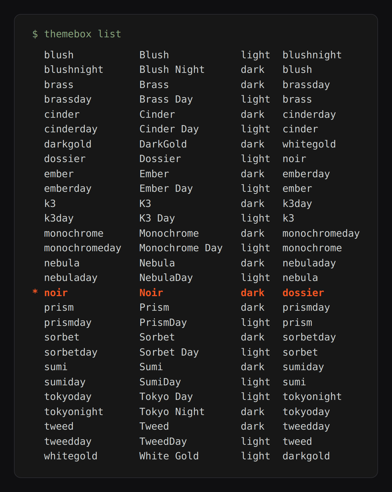
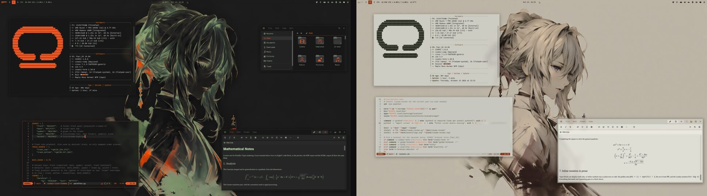

# cosmic-rice

One command to list your [COSMIC rices](https://atraxsrc.github.io/cosmic-rices/), switch between them,
and have the matching light or dark half follow COSMIC's toggle.



Flip the desktop to light and Noir becomes its light half, Dossier. Flip back and Noir returns:



It needs Python 3.10+ and nothing else. Keep this repo next to the `cosmic-*-theme` repos.

```bash
ln -s "$PWD/cosmic_rice.py" ~/.local/bin/cosmic-rice
```

## Use

```bash
cosmic-rice list                # every rice, * marks the active one
cosmic-rice switch noir         # make a rice active, --keep-icons leaves the icon theme alone
cosmic-rice pair                # match the rice to COSMIC's light/dark setting, once
cosmic-rice pair --watch        # keep matching it
cosmic-rice flip                # move to the other half and change everything live
cosmic-rice install-shell       # once: let flip reload open zsh shells
```

`flip` moves to the other half of the active rice. It applies the configs, imports the COSMIC theme,
sets the matching wallpaper, recolours running Neovims and reloads registered zsh shells. Then it sends
a notification with whatever is left, such as the Firefox add-on. It replaces COSMIC's stored theme for
that mode, so changes made in Settings are lost on the next flip.

`install-shell` adds one line to `~/.zshrc`. Terminals opened before that line existed are not reloaded.
Nothing is closed either way.

`switch` does what a rice's `scripts/switch.sh` does and backs up what it replaces (`*.bak`). If one
tool fails the others still run, the failures are listed at the end and the exit code is 1. It finishes
with the steps COSMIC only allows by hand, such as importing the theme.

`pair` needs both halves imported once in Settings → Desktop → Appearance, one in the Dark tab and one
in the Light tab. The active rice is whichever repo `~/update_system.sh` links into, so run `switch`
once first.

To follow the toggle from login, save this as `~/.config/systemd/user/cosmic-rice-pair.service`, then
run `systemctl --user enable --now cosmic-rice-pair`:

```ini
[Unit]
Description=Follow the COSMIC light/dark toggle with the matching rice

[Service]
ExecStart=%h/.local/bin/cosmic-rice pair --watch
Restart=on-failure

[Install]
WantedBy=default.target
```

## How it reads the rices

Each rice's settings come from the block at the top of its `scripts/switch.sh`, and its pair from the
link in its README. Set `COSMIC_RICE_REPOS` if the repos live somewhere else.

## Tests

```bash
python3 -m unittest discover -s tests
```

`tests/test_parity.py` runs every rice through both its `switch.sh` and this CLI in throwaway home
folders and compares every file they leave behind.

## License

MIT
