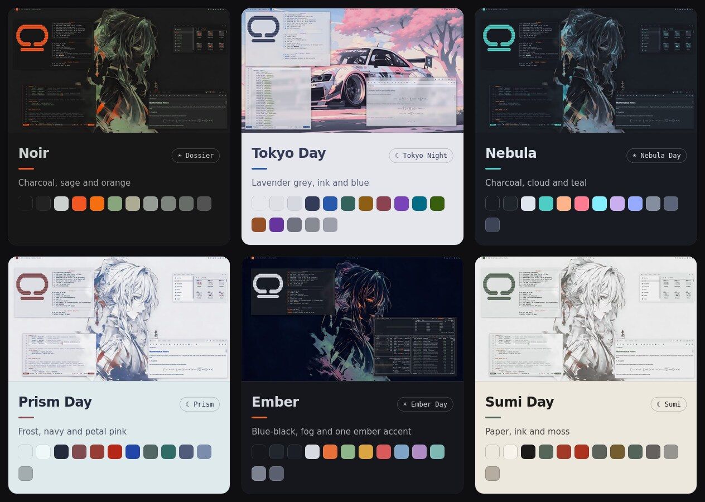

<p align="center">
  
</p>

<h1 align="center">Themebox</h1>

One command to list your [COSMIC rices](https://atraxsrc.github.io/cosmic-rices/), switch between them,
and have the matching light or dark half follow COSMIC's toggle.

[](https://atraxsrc.github.io/cosmic-rices/)

Flip the desktop to light and Noir becomes its light half, Dossier. Flip back and Noir returns:


## Install

```bash
curl -fsSL https://raw.githubusercontent.com/atraxsrc/themebox/master/install.sh | bash
themebox get noir            # download a rice and its other half
themebox switch noir         # make it active
themebox install-shell       # once: let a flip reload open zsh shells
```

Then add Themebox in Settings → Desktop → Panel → Configure panel applets. It needs git, curl and
Python 3.11+. Browse the rices in the [gallery](https://atraxsrc.github.io/cosmic-rices/); the name to use
is the part of the repo name between `cosmic-` and `-theme`.

Everything goes in `~/.local/share/themebox`, plus two files in `~/.local/bin` and one in
`~/.local/share/applications`. Run the same command again to update. The applet is prebuilt for x86_64; on
anything else the installer gives you the CLI, and `applet/install.sh` builds the applet from source.

The applet is not in the COSMIC Store: Store apps run in a sandbox, and this one has to change your config
files and reach your open shells.

To work on it, clone this repo next to the `cosmic-*-theme` repos and link `themebox.py` into
`~/.local/bin` as `themebox`.

## Use

```bash
themebox get noir            # download a rice and its other half
themebox list                # every rice, * marks the active one
themebox switch noir         # make a rice active, --keep-icons leaves the icon theme alone
themebox wallpaper noir      # list a rice's wallpapers
themebox wallpaper noir city # save one for that rice
themebox pair                # match the rice to COSMIC's light/dark setting, once
themebox pair --watch        # keep matching it
themebox flip                # move to the other half and change everything live
themebox switch noir --pick  # choose the wallpaper from a list, works on flip too
themebox choose noir k3day   # flip between these two instead of a rice's own pair
themebox choose --reset      # back to each rice's own pair
themebox capture Mine        # save the current theme and wallpaper as a new rice
themebox install-shell       # once: let flip reload open zsh shells
```

`flip` moves to the other half of the active rice. It applies the configs, imports the COSMIC theme,
sets the matching wallpaper, recolours running Neovims and reloads registered zsh shells. Then it sends
a notification with whatever is left, such as the Firefox add-on. It replaces COSMIC's stored theme for
that mode, so changes made in Settings are lost on the next flip.

`switch` and `flip` set each rice's wallpaper. It's the one you saved with `themebox wallpaper`, or the
one the rice had when you last left it, or else its anime wallpaper. Changing the wallpaper in Settings
counts too: it's what you come back to next time. The applet can't show a list, so it always uses the
saved one. With different wallpapers per monitor, themebox leaves them alone and tells you to pick by hand.

`install-shell` adds one line to `~/.zshrc`. Terminals opened before that line existed are not reloaded.
Nothing is closed either way.

`switch` does what a rice's `scripts/switch.sh` does and backs up what it replaces (`*.bak`). If one
tool fails the others still run, the failures are listed at the end and the exit code is 1. It finishes
with the steps COSMIC only allows by hand, such as importing the theme.

`pair` needs both halves imported once in Settings → Desktop → Appearance, one in the Dark tab and one
in the Light tab. The active rice is whichever repo `~/update_system.sh` links into, so run `switch`
once first.

To follow the toggle from login, save this as `~/.config/systemd/user/themebox-pair.service`, then
run `systemctl --user enable --now themebox-pair`:

```ini
[Unit]
Description=Follow the COSMIC light/dark toggle with the matching rice

[Service]
ExecStart=%h/.local/bin/themebox pair --watch
Restart=on-failure

[Install]
WantedBy=default.target
```

## Panel applet

`applet/` is a one-button panel applet that runs `themebox flip`. The icon is the logo's half moon in
dark mode and its half sun in light mode, and the logic stays in the CLI. It needs Rust and the libcosmic
build dependencies.

```bash
./applet/install.sh
```

Then add Themebox in Settings → Desktop → Panel → Configure panel applets.

## Make your own rice

The quick way is to set up COSMIC how you like it, then run `themebox capture Mine`. That makes
`cosmic-mine-theme` from your current light or dark theme, wallpaper, icon theme and fonts, without
changing your desktop. It leaves out everything else, like your terminal colours and other apps. A
wallpaper is only copied if it's one image on all monitors. Do it again in the other mode for the other
half, then add `pair` to each `rice.toml`.

By hand, a rice is a folder called `cosmic-<name>-theme`, where the name is lowercase letters and digits. Put it
in `~/.local/share/themebox`, or next to this repo if you cloned it, or anywhere with `THEMEBOX_REPOS`
set. It only needs a COSMIC theme exported to `cosmic/Mine.ron` and a `rice.toml`:

```toml
name = "Mine"
mode = "dark"                 # or light
theme = "Mine.ron"            # in cosmic/

# Optional
pair = "mineday"              # the other half, so a flip works
terminal = "Mine-term.ron"    # in cosmic-term/
btop = "Mine"                 # btop/Mine.theme
```

Everything else is optional too, and anything a rice doesn't have is skipped:

- `backgrounds/` holds its wallpapers. `<name>-anime.png` is the default, else the first file.
- `cosmic/config/` is copied over `~/.config/cosmic`: fonts, terminal look, icon theme.
- `<tool>/install.sh` runs for each tool it styles: `nvim`, `zsh`, `firefox`, `claude-desktop`, and
  `fastfetch`, `lsd`, `bat`, `starship`, `kitty`, `alacritty`, `wezterm`, `ghostty`, `delta`, `lazygit`,
  `helix`, `gtk`, `qt`, `discord`.

Without a `zsh` folder your `~/.zshrc` is left alone, and without an `nvim` folder so is your Neovim
config. With no `pair`, use `themebox choose <dark> <light>` to pick two rices to flip between.

Rices made before `rice.toml` still work: themebox reads the block at the top of their
`scripts/switch.sh` and the pair link in their README.

## Tests

```bash
python3 -m unittest discover -s tests
```

`tests/test_parity.py` runs every rice through both its `switch.sh` and this CLI in throwaway home
folders and compares every file they leave behind.

## License

MIT
